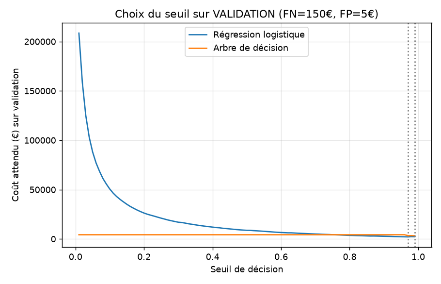
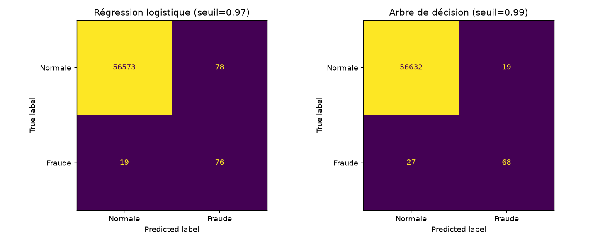
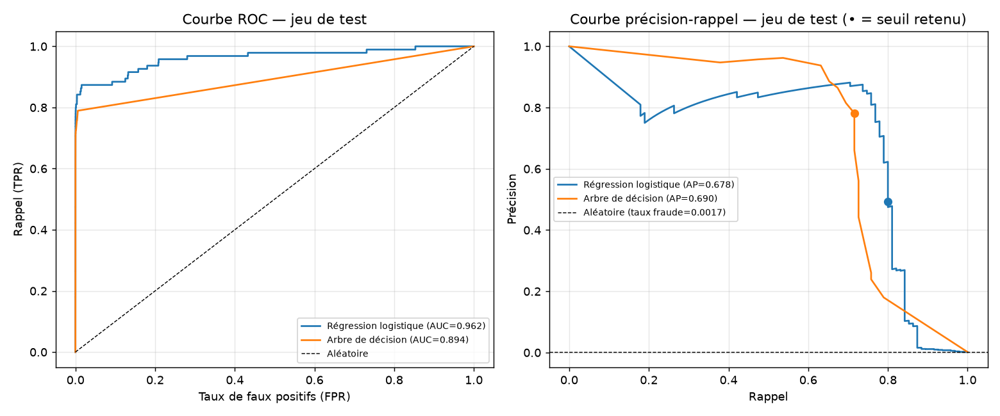

# 2. Rapport d'évaluation ML

*Activités 3 et 6.1. Pour reproduire : `python scripts/run_experiment.py` et `python scripts/temporal_validation.py`. Chiffres bruts : `reports/metrics.json`, `reports/temporal_validation.json`.*

## 2.1 Protocole

| Étape | Choix | Garde-fou |
|---|---|---|
| Données | 284 807 transactions, dont 492 fraudes (0,173 %). SHA-256 du contenu : `64d38533…7997d` | Empreinte enregistrée dans la baseline |
| Doublons | 1 081 doublons exacts supprimés **avant** le découpage | Test T09, `duplicated_rows_train_test = 0` |
| Découpage | Stratifié 60 / 20 / 20, graine 42 | Recouvrement des index = 0 (train/val, train/test, val/test) |
| Train | 170 235 lignes, 284 fraudes (0,167 %) | |
| Validation | 56 745 lignes, 94 fraudes (0,166 %) | Sert au réglage et au choix du seuil |
| Test | 56 746 lignes, 95 fraudes (0,167 %) | **Utilisé une seule fois**, à la fin |
| Transformations apprises | Imputation par la médiane et standardisation, dans un `Pipeline` ajusté sur le train | Test T05 : les statistiques du scaler sont celles du train |
| Hyperparamètres | Petite grille, choix sur la **PR-AUC de validation** | RL : C ∈ {0,001 ; 0,01 ; 0,1 ; 1}. Arbre : profondeur ∈ {4, 6, 8, 12} × min_samples_leaf ∈ {1, 20, 100} |
| Seuil | Minimise le coût de validation : 150 € par FN, 5 € par FP | Le seuil est figé avant la lecture du test |
| Choix du modèle | Coût de validation le plus bas | Le test n'intervient pas dans ce choix |

## 2.2 Hyperparamètres et seuils retenus (validation)

| Modèle | Paramètres retenus | PR-AUC val. | Seuil | Coût val. |
|---|---|---|---|---|
| Régression logistique | C = 0,01, `class_weight="balanced"` | 0,792 | 0,97 | **2 080 €** |
| Arbre de décision | max_depth = 12, min_samples_leaf = 20, `balanced` | 0,755 | 0,99 | 3 255 € |

→ **Modèle retenu : régression logistique.** Le choix repose sur le coût de validation, pas sur le test.

## 2.3 Tableau comparatif sur le jeu de test

| Modèle | Seuil | Précision | Rappel | F1 | FPR | FNR | ROC-AUC | PR-AUC | Accuracy | TP | FP | FN | TN | Coût |
|---|---|---|---|---|---|---|---|---|---|---|---|---|---|---|
| Référence naïve (toujours « normale ») | – | 0,000 | 0,000 | 0,000 | 0,00 % | 100 % | 0,500 | 0,0017 | **99,83 %** | 0 | 0 | 95 | 56 651 | 14 250 € |
| **Régression logistique** | 0,97 | 0,494 | **0,800** | 0,610 | 0,138 % | 20,0 % | **0,962** | 0,678 | 99,83 % | 76 | 78 | 19 | 56 573 | **3 240 €** |
| Arbre de décision | 0,99 | **0,782** | 0,716 | **0,747** | **0,034 %** | 28,4 % | 0,894 | **0,690** | 99,92 % | 68 | 19 | 27 | 56 632 | 4 145 € |

Intervalles de confiance à 95 % (bootstrap, 1 000 tirages) :

| Modèle | Rappel IC95 | Précision IC95 |
|---|---|---|
| Régression logistique | [0,720 ; 0,875] | [0,411 ; 0,572] |
| Arbre de décision | [0,622 ; 0,802] | [0,695 ; 0,862] |

### Matrices de confusion (TN en haut à gauche, FP en haut à droite, FN en bas à gauche, TP en bas à droite)

| Régression logistique | Prédit normale | Prédit fraude |
|---|---|---|
| **Réel normale** | TN = 56 573 | FP = 78 |
| **Réel fraude** | FN = 19 | TP = 76 |

## 2.4 Courbes ROC et précision-rappel

* **ROC** : la régression logistique domine nettement (AUC 0,962 contre 0,894). La courbe de l'arbre est presque faite de deux segments : un arbre ne produit que quelques valeurs de probabilité distinctes (une par feuille).
* **Précision-rappel** : c'est la courbe la plus informative ici, car la ligne de hasard est à 0,0017. Les deux modèles ont une PR-AUC proche (0,68 et 0,69). L'arbre est meilleur à faible rappel, la régression logistique au-delà de 0,75 de rappel. **Le point retenu pour la RL (rappel 0,80) est juste avant une falaise** : quelques transactions de plus au-dessus du seuil font chuter la précision (anomalie A-02).

## 2.5 Analyse des faux positifs et faux négatifs

* **Faux négatifs (19 pour la RL)** : 20 % des fraudes passent, soit environ 2 850 € de pertes au coût unitaire supposé. Ce sont des fraudes dont le profil sur V1–V28 ressemble à celui des transactions normales. Sans signification métier des variables PCA, on ne peut pas les caractériser davantage. Le seuil 0,5 en rattraperait 7 de plus, mais au prix de 1 554 faux positifs.
* **Faux positifs (78 pour la RL)** : environ 1 client légitime bloqué sur 725. Au total, 154 alertes sur 56 746 transactions (0,27 %), soit une charge réaliste pour une équipe d'analystes. Mais la moitié des alertes sont fausses.
* **Compromis selon le seuil** (RL, test) :

| Seuil | TP | FP | FN | Précision | Rappel | FPR |
|---|---|---|---|---|---|---|
| 0,50 (défaut) | 83 | 1 554 | 12 | 0,051 | 0,874 | 2,74 % |
| **0,97 (coût minimal, val.)** | 76 | 78 | 19 | 0,494 | 0,800 | 0,14 % |

  Avec `class_weight="balanced"`, les probabilités sont gonflées pour la classe rare et ne sont pas calibrées. Le seuil 0,5 n'a donc aucun sens métier : il produirait 20 fois plus de fausses alertes.
* **Arbre** : moins d'alertes et plus fiables (78 % de précision), mais 27 fraudes manquées. Avec un FN coûtant 30 fois plus qu'un FP, c'est le moins bon compromis économique.

## 2.6 Pourquoi l'accuracy est trompeuse

Le modèle naïf qui déclare **toutes** les transactions normales obtient **99,83 % d'accuracy**, exactement autant que la régression logistique, alors qu'il ne détecte **aucune** fraude (rappel 0, coût 14 250 €). Avec 0,17 % de positifs, l'accuracy est dominée par les vrais négatifs : elle ne mesure pas la capacité à détecter la fraude. Le test `test_accuracy_is_misleading_on_imbalanced_data` vérifie qu'un tel modèle est refusé par les critères d'acceptation. Les indicateurs pertinents sont le rappel, la précision, la PR-AUC, le FPR et le coût métier.

## 2.7 Généralisation et surapprentissage (6.1)

| Modèle | Jeu | Précision | Rappel | PR-AUC | ROC-AUC |
|---|---|---|---|---|---|
| RL | Train | 0,478 | 0,856 | 0,726 | 0,991 |
| RL | Validation | 0,491 | 0,883 | 0,792 | 0,981 |
| RL | Test | 0,494 | 0,800 | 0,678 | 0,962 |
| Arbre | Train | 0,763 | 0,803 | **0,853** | **0,999** |
| Arbre | Validation | 0,777 | 0,777 | 0,755 | 0,909 |
| Arbre | Test | 0,782 | 0,716 | 0,690 | 0,894 |

* **RL** : aucun surapprentissage (train ≈ validation). La baisse validation → test (PR-AUC −0,11, rappel −0,08) correspond à environ 8 fraudes sur 95. C'est cohérent avec la variance attendue sur un si petit effectif (IC95 du rappel : [0,72 ; 0,875]).
* **Arbre** : surapprentissage net. ROC-AUC 0,999 sur le train contre 0,894 sur le test, PR-AUC 0,85 contre 0,69.

### Validation hors période (découpage chronologique)

Pour un scoring en production, on prédit le **futur**. On rejoue donc le protocole avec un découpage chronologique : train de 0 à 33,4 h, validation de 33,4 à 40,3 h, test de 40,3 à 48 h (74 fraudes).

| Modèle | Paramètres (val.) | Seuil | Précision | Rappel | FPR | PR-AUC | ROC-AUC |
|---|---|---|---|---|---|---|---|
| RL | C = 1 | 0,99 | 0,458 | 0,811 | 0,13 % | 0,745 | 0,981 |
| Arbre | d = 12, leaf = 20 | 0,99 | 0,457 | 0,716 | 0,11 % | 0,646 | 0,864 |

Le classement des modèles est le même et la RL garde un rappel d'environ 0,81, mais **la précision reste sous 0,50**. Le seuil retenu atteint la borne de la grille (0,99), ce qui signale des probabilités mal calibrées (anomalie A-08).

## 2.8 Critères d'acceptation métier

Les critères ont été fixés **avant** l'évaluation (`app/config.py`, premier commit) à partir des coûts et de la capacité d'analyse. Ils n'ont **pas** été ajustés après la lecture du test.

| Critère | Seuil | RL (test) | Arbre (test) |
|---|---|---|---|
| Rappel | ≥ 0,75 | 0,800 ✅ | 0,716 ❌ |
| Précision | ≥ 0,50 | 0,494 ❌ (de justesse) | 0,782 ✅ |
| FPR | ≤ 0,5 % | 0,138 % ✅ | 0,034 % ✅ |
| PR-AUC | ≥ 0,70 | 0,678 ❌ | 0,690 ❌ |
| ROC-AUC | ≥ 0,90 | 0,962 ✅ | 0,894 ❌ |
| **Décision** | | **Non accepté (2 critères sur 5 en échec)** | **Non accepté (3 critères sur 5 en échec)** |

**Interprétation.** La régression logistique est le meilleur candidat : elle a le coût le plus faible, sur la validation comme sur le test, et ne surapprend pas. Elle n'atteint cependant **pas** le niveau exigé pour décider automatiquement. Une alerte sur deux est fausse, et la qualité de classement sur la classe rare (PR-AUC) est sous l'objectif. Les petits effectifs (95 fraudes) rendent ces deux écarts statistiquement incertains : l'IC95 de la précision, [0,41 ; 0,57], contient le seuil. Cela ne permet ni de conclure à un succès, ni d'ajuster le critère après coup. La suite est donnée dans le rapport final.
